# 🏥 Clinic Management for Odoo 18


A free, open-source **Odoo 18** module that runs a small clinic end to end: public online booking, a patient portal, doctor schedules, a waiting-room queue, prescriptions with a printable Rx, lab tests, invoicing and a live dashboard.

## Features

**For patients (website)**
- 📅 **Online booking** at `/book-appointment`: pick a doctor, see free time slots, confirm.
- 🔐 **Patient login** at `/clinic/login` and a **patient portal** at `/my/clinic`: upcoming visits, history, invoices, prescriptions.
- 📄 **Download the prescription (Rx) as a PDF** from the portal.
- Cancel an upcoming appointment, see follow-up dates and doctor availability.

**For the clinic (Odoo backend)**
- 👥 **Patients** with auto-numbered IDs and a full history tab.
- 🩺 **Doctors** with specialty, qualifications, registration number, fee and a **weekly schedule**.
- 🗓 **Appointments** with a status flow (draft → confirmed → in progress → done / cancelled), chatter, and a printable slip.
- 🔢 **Patient queue** with token numbers for the waiting room.
- 💊 **Drug catalog + free-text prescriptions.** The doctor writes the prescription; the clinic does not sell medicine, so there is no stock.
- 📝 **Consultation notes:** chief complaint, diagnosis, advice, follow-up date, investigations.
- 🖨 **Printable A4 prescription (Rx)** with doctor details and signature.
- 🧪 **Lab tests** linked to the appointment.
- 💰 **Invoicing** through Odoo Accounting.
- 📊 **Dashboard** with KPIs, today's schedule and upcoming follow-ups.
- ⏰ **Automatic appointment reminders** (email template + scheduled action).
- 🩺 **Vitals and triage:** BP, pulse, temperature, SpO₂, weight and height with automatic BMI category and an abnormal-vitals alert banner.
- ⚠️ **Drug-allergy guard:** warns when a prescribed drug matches the patient's recorded allergies.
- 📋 **Rx protocols:** apply a saved protocol (diagnosis, advice, medicines, follow-up) in one click, or save any prescription as a protocol.
- 📺 **Lobby TV display** at `/clinic/tv`: live "now serving" and waiting queue with a chime and voice announcement.
- 🔒 **Access groups:** receptionist and doctor.

## Requirements

- Odoo **18.0** (Community or Enterprise)
- Odoo apps this module depends on: `base`, `mail`, `calendar`, `account`, `portal`, `website`
- `wkhtmltopdf` installed (standard for Odoo) so PDF reports work

## Installation

1. Clone into your Odoo custom add-ons folder:
   ```bash
   cd /path/to/odoo/custom_addons
   git clone https://github.com/matiur-rahman1/Clinic_management-.git clinic_management
   ```
   The folder must be named `clinic_management`.
2. Make sure `custom_addons` is in `addons_path` in your `odoo.conf`.
3. Restart Odoo, then update the module list: **Apps → Update Apps List**.
4. Search for **Clinic Management** and click **Install**.

To upgrade after pulling new changes:
```bash
python odoo-bin -c odoo.conf -d <your_database> -u clinic_management
```

## Quick start

1. Add doctors (**Clinic → Doctors**) and set their weekly schedule.
2. Add a few drugs to the **Drug Catalog** (optional, doctors can also type any drug).
3. Open `http://localhost:8069/book-appointment` and book a test appointment.
4. Log in at `/clinic/login` to see the patient portal at `/my/clinic`.
5. In the backend, open the appointment, write the prescription, press **Print Rx**.

## Screenshots

> Real captures of the running Odoo 18 app (headless Chrome, 1440×900). Patient names and queue entries are **sample data** created only for the captures.

### Dashboard
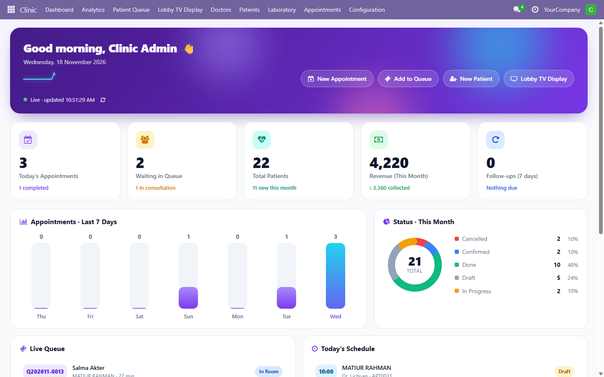

### Appointment: vitals, BMI, abnormal-vitals and drug-allergy alerts
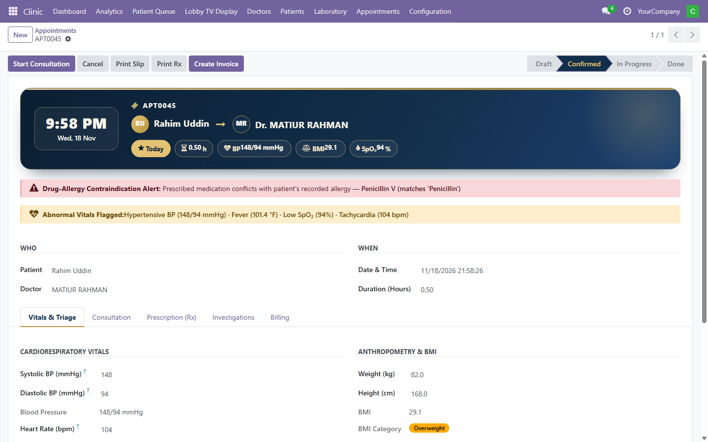

### Prescription (Rx) with one-click protocols
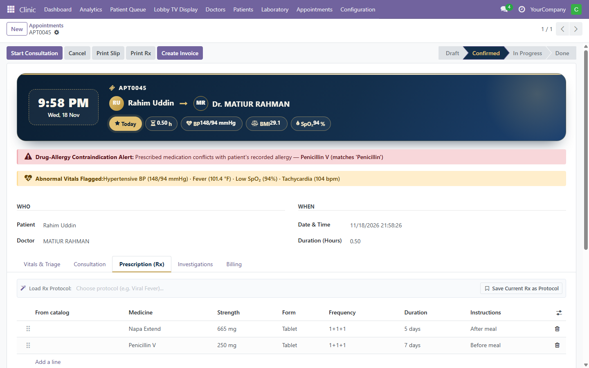

### Appointments
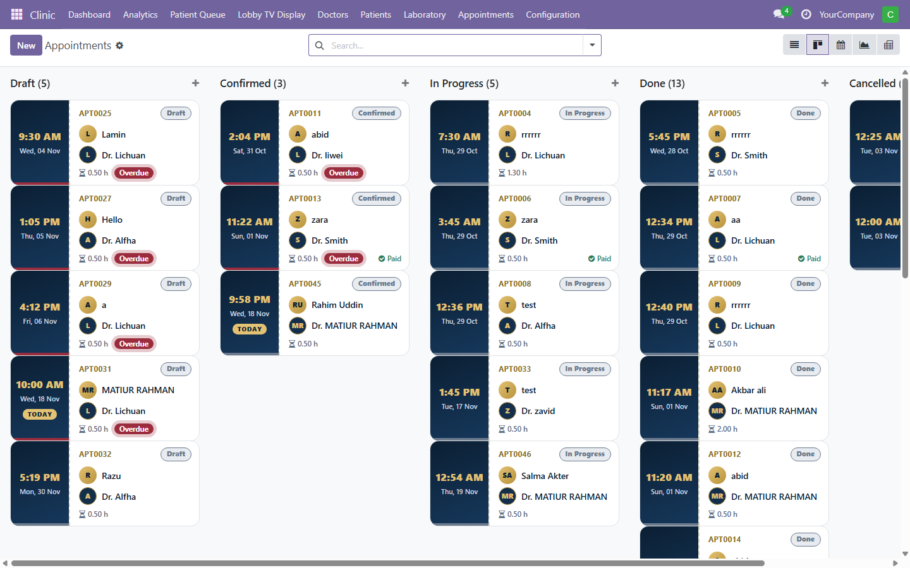

### Patients and Doctors
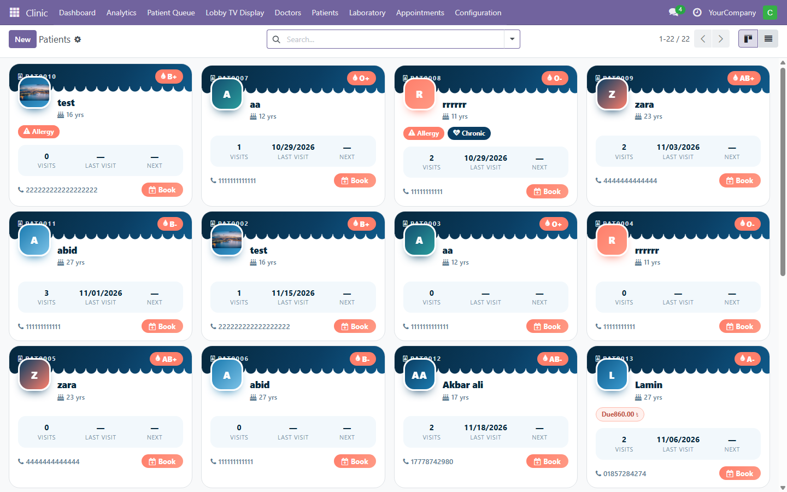
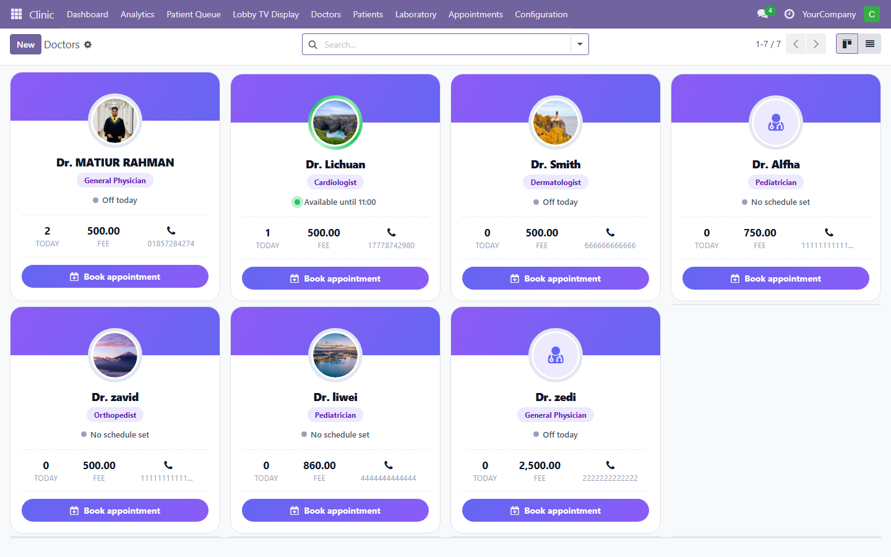

### Patient queue and lobby TV display (`/clinic/tv`)
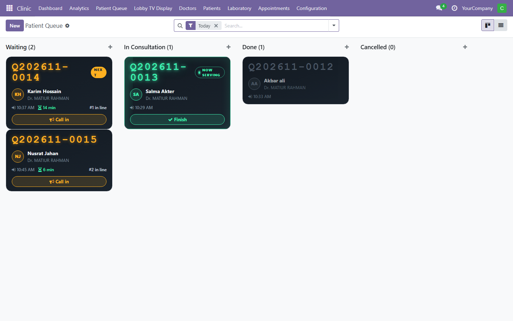
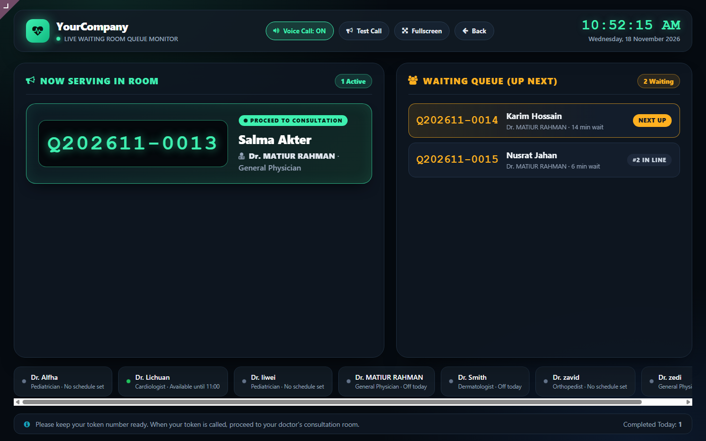

### Laboratory and Rx protocols
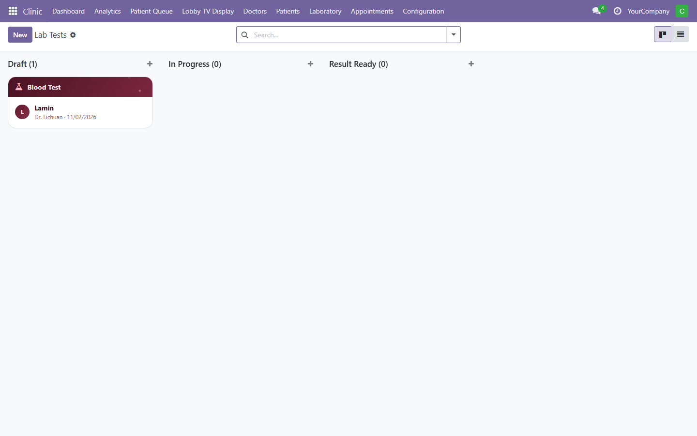
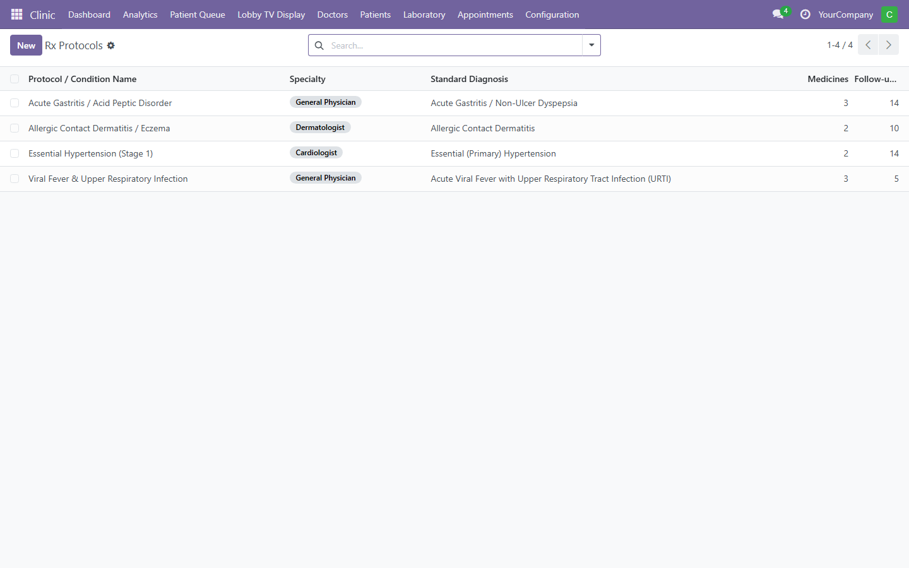

### Public website: online booking and patient login
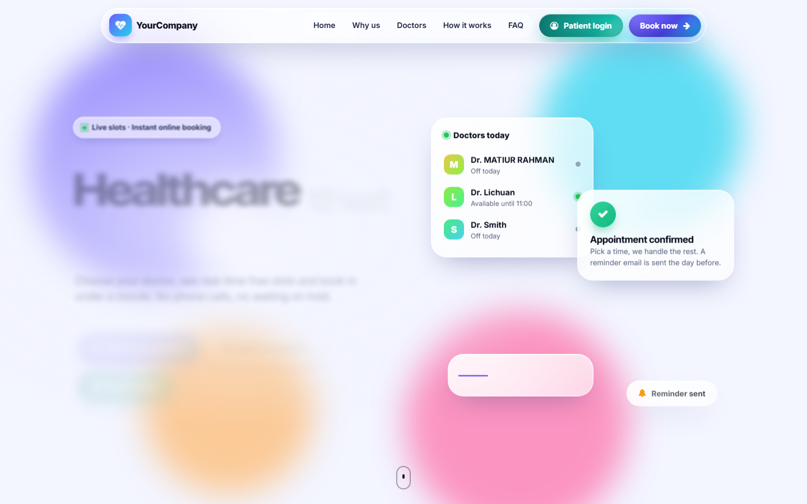
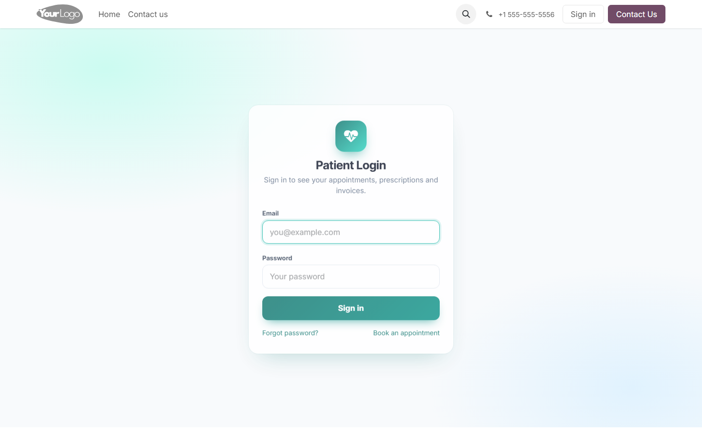

## Testing

Automated tests live in `tests/test_clinic.py` (9 tests): sequences and billing contact, doctor double-booking prevention, appointment/queue workflow, vitals and BMI, abnormal-vitals alerts, drug-allergy guard, Rx protocols, dashboard data and free-slot availability.

```bash
python odoo-bin -c odoo.conf -d <your_database> -u clinic_management --test-enable --test-tags /clinic_management --stop-after-init
```

## Project structure

```
clinic_management/
├── __manifest__.py
├── controllers/     # website booking, patient portal, login, Rx download, lobby TV
├── models/          # patient, doctor, schedule, appointment, queue, lab test,
│                    # drug catalog, prescription, Rx templates, dashboard, invoice link
├── views/           # backend views, portal, website and TV templates
├── reports/         # appointment slip and prescription (Rx) PDFs
├── security/        # groups, access rights, portal rules
├── data/            # sequences, reminder email and cron, Rx protocol samples
├── migrations/      # database migrations between versions
├── tests/           # automated tests
├── screenshots/     # README images
└── static/src/      # dashboard (OWL), slot picker, styles
```

## Notes

- Educational and small-clinic use. Review security, backups and local health-data regulations before using it with real patient data.
- Prescriptions are written by doctors; the module does not manage pharmacy stock.

## Contributing

Issues and pull requests are welcome. Please open an issue first to discuss large changes.

## License

LGPL-3, as declared in `__manifest__.py`. See `LICENSE` if present in the repository.

## Author

**Rahman Md Matiur**: [GitHub](https://github.com/matiur-rahman1)
